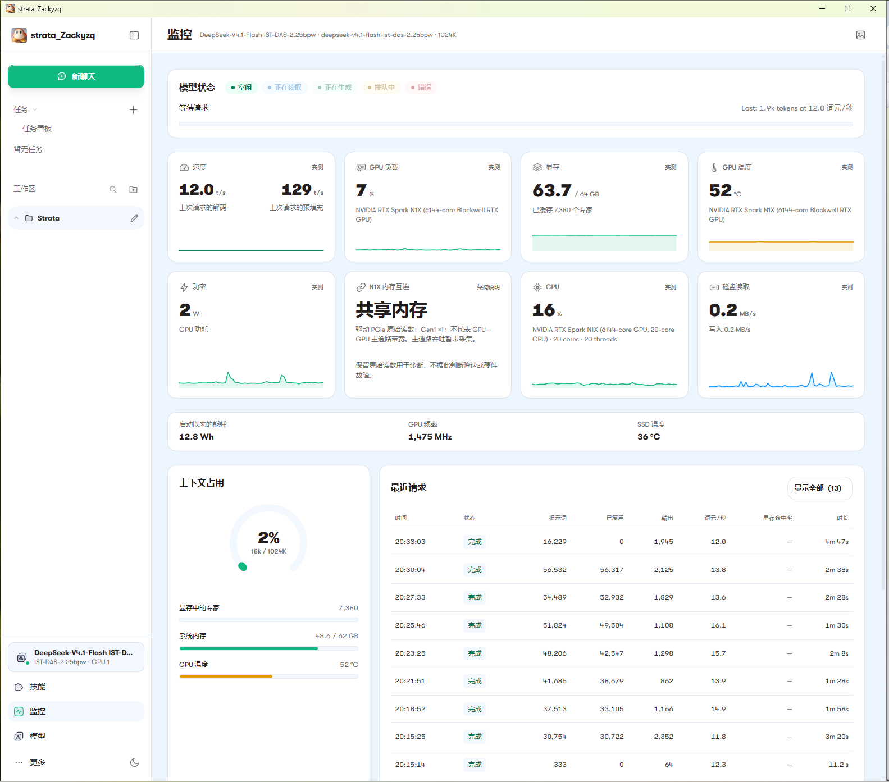
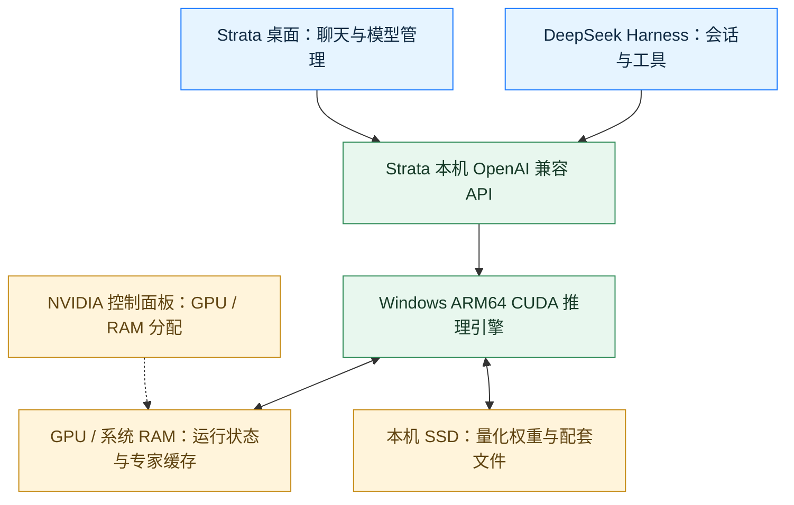
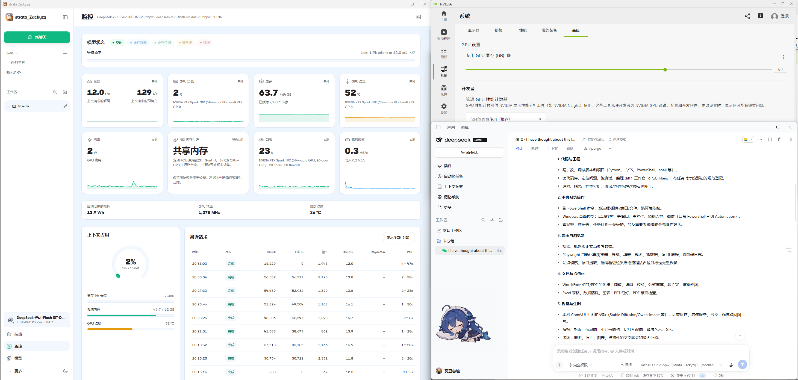

# Strata N1X — DeepSeek-V4.1-Flash-1017 on Windows ARM64

**让 N1X 128GB 笔记本成为本地 DeepSeek 工作台：原生 CUDA 推理、桌面模型管理、DeepSeek Harness 接入。**

[项目说明页](https://zackyangzeqi-spec.github.io/strata-n1x-Zackyzq/) · [下载安装包](https://github.com/zackyangzeqi-spec/strata-n1x-Zackyzq/releases/tag/v0.2.8-n1x.1) · [安装指南](docs/INSTALL.md) · [接入 DeepSeek Harness](docs/DSH.md) · [已有实测](docs/BENCHMARKS.md) · [常见问题](docs/FAQ.md) · [让 AI 协助](docs/AI-ASSISTED.md)

**Strata N1X** 是由 **[Zack_yzq](https://github.com/zackyangzeqi-spec)** 维护、基于 [Strata](https://github.com/Niko1221/Strata) 的免费社区适配，面向 **NVIDIA RTX Spark N1X、128GB CPU/GPU 统一内存、Windows ARM64 笔记本**。它把本地模型加载、卸载、运行监控和本机 API 接入整理到一个桌面工作流中。

本项目运行的是 **DeepSeek 官方于 2026 年 10 月 17 日更新的 [DeepSeek-V4.1-Flash-1017](https://api-docs.deepseek.com/zh-cn/updates/)** 的第三方量化版本，采用 [ISTA-DASLab GSQ-RCO GGUF](https://huggingface.co/ISTA-DASLab/DeepSeek-V4.1-Flash-1017-GSQ-RCO-GGUF) 路线。维护者已在自己的微软 N1X 128GB 笔记本上取得 **1.75 / 2.25bpw 实际模型回复**，并记录了 **DeepSeek Harness（DSH）两轮基础聊天与提示词缓存复用**。

**English:** Run quantized **DeepSeek-V4.1-Flash-1017 locally on NVIDIA RTX Spark N1X 128GB laptops**, using a **native Windows ARM64 CUDA inference engine**, Strata desktop controls and a local **OpenAI-compatible API for DeepSeek Harness**. This community preview includes an installer, setup guides and maintainer observations. The recorded native inference route requires neither LM Studio nor a WSL inference bridge. See [project facts](docs/PROJECT-FACTS.md) for the tested scope.

## 先看是否适合你

| 你关心的事 | 本项目提供什么 |
|---|---|
| 在 N1X Windows 笔记本上运行 1017 | Windows ARM64 原生 CUDA **推理引擎**；控制层仍包含仿真的 x64 Python |
| 用自己的本地模型聊天 | 桌面加载、卸载与运行监控；安装包不包含权重或 NVIDIA 驱动 |
| 给 DeepSeek Harness 提供本地后端 | Strata 本机 OpenAI 兼容 API；DSH 管理会话及其工具 |
| 看清速度与等待时间 | 已有请求、缓存和磁盘配置记录；解码速度与整轮等待分别说明 |
| 不熟悉部署或想继续改造 | 可复制的 [AI 协助提示词](docs/AI-ASSISTED.md) 与有公开依据的 [适配说明](docs/DEVELOPMENT-NOTES.md) |

**当前状态：Experimental Preview / 社区实验性预览。** 已记录的是维护者单台微软 N1X 设备的结果；普通 Windows x64、Mac、DGX Spark 和其他 N1X 机型不能仅凭“128GB 内存”视作兼容。128GB 是 CPU/GPU 共享总容量。更多条件见 [FAQ](docs/FAQ.md)。

## 从哪里开始

| 你的目标 | 阅读入口 | 得到什么 |
|---|---|---|
| 直接使用 | [安装指南](docs/INSTALL.md) → [Release](https://github.com/zackyangzeqi-spec/strata-n1x-Zackyzq/releases/tag/v0.2.8-n1x.1) | 安装包、SHA256、已有模型的准备与使用路径 |
| 连接 DeepSeek Harness | [DSH 接入说明](docs/DSH.md) | Base URL、模型 ID、历史配置和超时前提 |
| 判断性能是否符合预期 | [已有实测](docs/BENCHMARKS.md) | 分量化、分场景的历史数据与截图 |
| 修改或研究适配 | [构建边界](docs/BUILD.md) · [适配说明](docs/DEVELOPMENT-NOTES.md) | 固定上游基线、公开补丁、已知构建条件 |
| 希望自己的 AI 帮忙 | [AI 协助提示词](docs/AI-ASSISTED.md) | 环境判断、安装排查、另行授权的继续开发提示词 |

使用安装包无需先执行源码构建流程。下载 `strata_Zackyzq_0.2.8_arm64-setup.exe` 后按安装指南使用；需要自行准备兼容的模型文件与驱动。项目公开的是固定上游基线的适配补丁和配套材料，完整干净源码构建尚未获得独立验证。

## 它们怎样连接

在这条已记录的路线中，**Strata 提供本地推理服务，DSH 连接该服务**。GPU/RAM 分配属于 NVIDIA 的硬件与驱动能力；本项目负责对应的推理、桌面与运行配置适配。模型推理在本机完成，DSH 的搜索、插件、远程工具是否联网取决于各自配置。

## 已有表现：把条件和数字一起看

| 记录 | 已公开观察 | 如何理解 |
|---|---|---|
| **2.25bpw 桌面截图** | UI 汇总 **13 次请求，平均输出 13.3 tokens/s** | UI 报告的会话内统计；截图可见 12 条请求，未独立重算平均值 |
| 2.25bpw 可见单次请求 | **16.1 tokens/s，输出 1,108 tokens** | 同次提示词 51,824、复用 49,504、整轮约 90 秒 |
| 2.25bpw 最大可见提示词 | **56,532 tokens，其中复用 56,317** | 证明该条请求与缓存记录；配置 1024K 不等于完成满 1M 输入验证 |
| 1.75bpw 历史短回复 | **113 tokens，20.0 tokens/s** | 单独的缓存短回复，不能代替 2.25bpw 的持续性能 |

上述均为已有观察，包含不同量化与缓存条件。完整表保留 **1.7、7.2、9.2、9.3 tokens/s** 等较慢或对照结果；不把精选数字当成所有请求的速度范围。首个引擎 token 还可能是推理内容，不能直接当成第一段正文出现的时间。查看 [完整口径、截图和数据](docs/BENCHMARKS.md)。

## DeepSeek Harness 接入到哪一步

默认示例为 `http://127.0.0.1:47831/v1`，本地模型 ID 为 `deepseek-v4.1-flash-ist-das-2.25bpw`；实际值以本机 Strata 为准。先在 Strata 加载模型，再在 DSH 选择相应提供方及模型。

历史记录支持 **两轮基础聊天和缓存复用**，其中开发机使用过未随包发布的本地 HTTP 超时扩展。DSH 的实际测试版本、扩展在其他版本上的必要性尚未完整记录；不能把这次聊天结果推成所有 DSH 工具、记忆、微信或长时间 Agent 任务已验收。完整前提已保留在 [DSH 指南](docs/DSH.md)。

此图由维护者明确授权公开，用于展示界面关系；图内模型生成的能力描述不构成对所有工具能力的独立证明。

## 项目资料、来源与支持

- [项目说明页维护](docs/PUBLISHING.md)：网页发布、分享图与搜索入口的维护方法。
- [项目事实表](docs/PROJECT-FACTS.md)：模型身份、平台、版本、已验证范围与证据入口。
- [适配说明](docs/DEVELOPMENT-NOTES.md)：从公开补丁理解本项目贡献，区分可确认实现与原因推断。
- [源码构建](docs/BUILD.md)：基于上游 `870aedd9e1ebe1c91f94da93b59af17729f6c5c0` 的补丁；并非已经验证一键构建的完整源码分发。
- [发布范围](docs/RELEASE-CHECKLIST.md)：独立干净账户、其他机器、完整 1M 输入、长任务稳定性等尚未全面验证。

基于 [Niko1221/Strata](https://github.com/Niko1221/Strata)，保留 Strata、Project Maya、ggml 及依赖归属与许可。维护者为 **[Zack_yzq](https://github.com/zackyangzeqi-spec)**，应用显示名为 **strata_Zackyzq**。这是免费社区项目，不是 Microsoft、NVIDIA、DeepSeek 或 Strata 官方发行版；安装包目前未签名。适配代码按 [LICENSE](LICENSE) 授权，运行库及图片分别遵守 [ASSETS](docs/ASSETS.md) 和第三方许可。

如果项目帮助你解决了 N1X 本地部署问题，欢迎 Star 收藏，也欢迎[关注 Zack_yzq 的后续项目](https://github.com/zackyangzeqi-spec)、分享具体使用体验，或在 [Issues](https://github.com/zackyangzeqi-spec/strata-n1x-Zackyzq/issues) 留下脱敏反馈。[微信／支付宝自愿支持](sponsorship/README.md) 不作为使用或反馈的前提，也不购买支持、优先回复或交付承诺。

No model weights, credentials, private runtime profiles or raw development chats are distributed. The existing project/payment images and three demonstration screenshots retain the maintainer's publication authorization. Other private logs and conversations are excluded. This is a community preview, with no general compatibility or performance guarantee.
