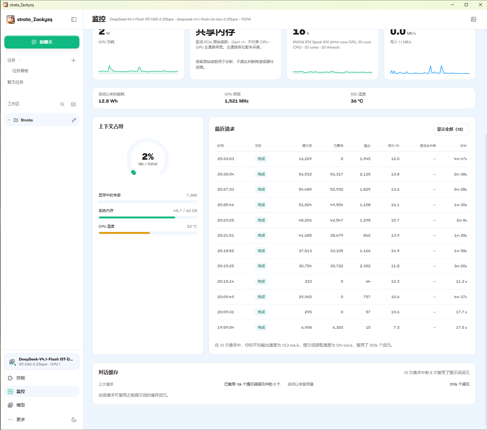

# Measured performance / 实测表现 — 2026-10-31

**Selected native desktop decode examples: 9.3–20.0 tokens/s across different quantizations and cache conditions.** This is not the complete min/max range, a sustained-speed promise or a controlled cross-engine ranking. Slower results remain below.

## Current 2.25bpw usage / 当前版本实际使用

The maintainer supplied the following desktop screenshots. The header identifies DeepSeek V4.1 Flash IST-DAS-2.25bpw; the monitor reports 64GiB GPU and approximately 62GiB visible system RAM. The UI summary reports **13 requests, 13.3 tokens/s average output speed, 124 tokens/s prompt-reading speed and about 310K reused prompt tokens**. This is a UI-reported session aggregate, not an independently rerun benchmark.

可见单次最高 **16.1 token/s**，输出 **1,101 tokens**，提示词 **51,824**、复用 **49,504**，整轮约 **90秒**。最后一轮 **12.0 token/s**、输出 **1,945 tokens**，输入 **16,229**、未复用，整轮约 **287秒**。截图可见的单次范围为 **7.3–16.1 token/s**；它不是全部场景的速度保证。

The second image shows 12 visible request rows while the UI aggregate says 13. The aggregate is retained as reported; no missing row is invented. Visible input reaches **56,532 tokens**, not one million. Whole-machine idle resource samples are not generation peaks. GPU power shown at idle is not total laptop consumption.

## 1.75bpw historical desktop sample / 较低精度历史记录

Native Windows ARM64, 92GiB GPU + 36GiB nominal RAM, internal SSD. One cached reply produced **113 tokens at 20.0 tokens/s**, with **14,309 prompt tokens / 14,255 reused**, **1.272s first engine token**, **6.9s request duration** and **5.6542s decode time**. Draft counters: 98 offered / 92 accepted. Fourteen non-warmup requests together produced 3,457 tokens at approximately **13.30 tokens/s weighted by decode time**. These were different real chat prompts, not standardized questions. No private prompt text is published.

|Quantization / 精度|Nominal GPU + RAM GiB|Scenario / 场景|Decode tokens/s|First engine token s|Request s|
|---|---|---|---:|---:|---:|
|1.75|92 + 36|Short cached reply, 113 output tokens|20.0|1.272|6.9|
|1.75|80 + 48|First comparison request, no prompt reuse|9.8|62.4|211.1|
|1.75|80 + 48|Cached follow-up|13.7|1.585|17.9|
|1.75|64 + 64|Same comparison question, prompt reuse present|12.2|14.051|204.7|
|2.25|64 + 64|External-SSD experts, internal shared files|1.7|222.015|466.1|
|2.25|64 + 64|Internal SSD, 4GB expert RAM cache|7.2|71.442|136.7|
|2.25|64 + 64|Internal SSD, 12GB expert RAM cache|9.3|69.454|148.7|
|2.25|64 + 64|Internal SSD, 16GB expert RAM cache|9.2|70.139|150.0|

For the 2.25 RAM-cache comparison, each request had 11,548 prompt tokens and zero prompt reuse; output lengths were 473 / 736 / 735 respectively. Six experts, DSpark auto and 1024K configured context were used. 12GB was retained: 16GB gave no observed speed gain and reduced free RAM. Single trials, OS file cache not flushed, different output lengths and draft acceptance: **not a strict randomized comparison**. External-SSD performance here does not characterize all USB SSDs.

## Definitions and reusable evidence / 口径与复测

- Decode tokens/s measures generated tokens per decode time, including reasoning when counted by the engine. It is not output tokens divided by whole-request duration.
- First engine token can be reasoning; it is not necessarily the first visible answer. Prompt processing, reasoning and tool waits affect user-visible latency.
- 1024K is a configured ceiling; full 1M input is untested. No general intelligence ranking is inferred from speed.
- [CSV](../benchmarks/observations.csv) and [JSON](../benchmarks/observations.json) contain only approved numeric observations and public configuration labels, not private request IDs or prompt text.
- [Public prompts](../benchmarks/prompts.json) and [reproduction protocol](../benchmarks/README.md) are a **new reusable suite**. They were not the source of the historical results above. No new model run is claimed in this documentation update.

The screenshot-derived rows are manual transcriptions of displayed rounded values. Historical rows are allowlisted extracts from saved measurements. Both have explicit provenance labels. Future independent measurements should record model quantization, engine build, memory split, SSD placement, cache state, prompt/reused/output counts, first-token timing and full duration.
